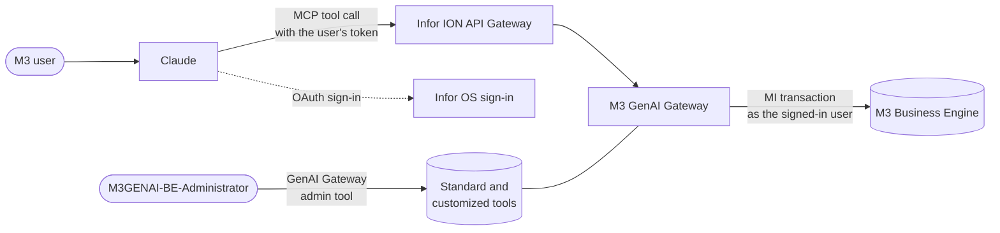

# Infor Industry AI Connector for M3 – Setup and Reference

## Overview

The Infor Industry AI connector lets Claude look up and act on Infor M3 data, such as customer orders, purchase orders, manufacturing orders, items, stock and customers, through M3 Business Engine (BE) APIs.

M3 GenAI Gateway exposes M3 MI transactions as Model Context Protocol (MCP) tools, and Claude reaches it through Infor ION API Gateway. Each tool wraps one M3 MI transaction, for example CRS610MI GetBasicData. Field names are rewritten from four-character M3 codes to readable names, and status codes can be presented as named values.

This page is for the people who set the connector up and for users who connect Claude to M3. Setting it up involves three roles: a user with the IFS role `M3GENAI-BE-Administrator`, who reviews the tools; a user with the `IONAPI-Administrator` role, who registers Claude in ION API; and a Claude Owner or Primary Owner, who adds the connector to Claude.

The role-based skills for buyers, production planners and customer service reps are a separate install: the Infor Industry AI plugin in this repository. The plugin uses this connector.

### How it works



1. Each user connects Claude to M3 once, by signing in with their Infor OS account.
2. When Claude needs M3 data, it calls a tool. The call goes to ION API Gateway with the user's access token.
3. M3 GenAI Gateway runs the MI transaction in M3 as that user, so M3 security applies as it does in M3 itself.
4. The result comes back with readable field names, and with only the fields enabled in GenAI Gateway.

## Prerequisites

Before connecting Claude, make sure the following are in place.

- An Infor M3 tenant with Business Engine MI transactions available through the M3 API Gateway (`/m3api-rest/v2`).
- Velocity Suite for that tenant. It includes M3 GenAI Gateway, which provides the MCP endpoints through Infor ION API Gateway.
- A user with the IFS role `M3GENAI-BE-Administrator`, to review and customize tools in the GenAI Gateway admin UI.
- A user with the `IONAPI-Administrator` role, to register Claude as an authorized application in ION API.
- For each person who will use the connector, an M3 user account with authority for the M3 programs whose tools they will call (see [M3 roles and permissions](#m3-roles-and-permissions)).
- On Claude Team and Enterprise plans, a Claude Owner or Primary Owner to add the connector for the organization. On Enterprise, a custom role with **Manage access to Libraries** can also add it. On Free, Pro and Max plans, each user adds it.

No network allow-listing is needed. Claude reaches the tenant through ION API Gateway over the public internet.

## Setup

| Part | Who | Where |
|---|---|---|
| [Part 1: Review the tools](#part-1-review-the-tools-m3genai-be-administrator) | IFS role `M3GENAI-BE-Administrator` | Infor Portal > M3 > **Administration Tools** > **GenAI Gateway** |
| [Part 2: Register Claude in ION API](#part-2-register-claude-in-ion-api-ionapi-administrator) | `IONAPI-Administrator` | Infor OS Portal > **API Gateway** > **Authorized Applications** |
| [Part 3: Add the connector in Claude](#part-3-add-the-connector-in-claude-claude-owner-or-primary-owner) | Claude Owner or Primary Owner | Claude > **Organization settings** > **Connectors** |
| [Part 4: Connect Claude](#part-4-connect-claude-each-user) | Each user | Claude > **Customize** > **Connectors** |
| [Check that it works](#check-that-it-works) | Each user | A Claude conversation |

### Part 1: Review the tools (`M3GENAI-BE-Administrator`)

1. Sign in to Infor Portal with an account that has the IFS role `M3GENAI-BE-Administrator`, and open M3.
2. Under **Administration Tools**, click **GenAI Gateway**.
3. On the **Standard** tab, review the tools that are available. Open a tool to see all of its input and output fields. Agents can use only the fields that are enabled.
4. To change a tool, click **Copy** in the **Details** form. The customized version replaces the standard tool. If you give it a sub-name, it appears as a separate tool.
5. Edit the tool description, enable or disable fields, and change field long names, descriptions, types or enum values as needed. Update any instructions that refer to a renamed field.
6. To turn a customized tool off, disable it. Disabling a customized tool that has no sub-name returns to the standard tool. Standard tools can't be turned off for a tenant.

> [!IMPORTANT]
> A copied or new tool starts disabled. Users don't see it, and the standard tool stays in use, until you enable it.

Customized tools are listed on the **Customized** tab. To create a tool that has no standard version, click **+** in the **Tools** list and enter the **Program**, **Transaction** and optional **Sub-name**, for example `CRS610MI` and `GetBasicData`.

The Infor Industry AI skills also use tools outside the standard set, and some standard tools with other settings. To create them in a tenant, or to check a tenant against what the skills use, see [GenAI Gateway tool scripts](../scripts/genai-gateway/README.md).

### Part 2: Register Claude in ION API (`IONAPI-Administrator`)

1. In Infor OS Portal, open **API Gateway** and go to **Authorized Applications**.
2. Add a new non-Infor authorized application and fill in the form:

   | Field | Value |
   |---|---|
   | **Name** | A name for the application, for example `Claude` |
   | **Type** | **MCP Client** |
   | **Description** | For example `Claude connector for Infor M3` |
   | **Redirect URL** | `https://claude.ai/api/mcp/auth_callback` |
   | **OAuth 2.1 Access Token** | Keep the default, **2 Hours** |
   | **Issue Refresh Tokens** | On. Without refresh tokens, users must sign in again each time the access token expires. |

3. Under **MCP Server Access**, select **Infor M3** (endpoint `M3/service/genai-gateway/mcp/be/`). This allows the application to access the M3 MCP server only.
4. Save the application. ION API generates the **Client ID**.
5. Under **MCP Client Configuration**, the `mcp.json` snippet shows the connector URL (`url`) and the client ID (`clientId`) for your tenant. Click **Copy**, and pass both values to the person who adds the connector in Claude.

The snippet has this form, with your tenant's values:

```json
{
  "mcpServers": {
    "m3-emscmcp": {
      "type": "http",
      "url": "https://mingle-ionapi.inforcloudsuite.com/<tenant>/M3/service/genai-gateway/mcp/be/",
      "oauth": {
        "clientId": "<client ID>"
      }
    }
  }
}
```

### Part 3: Add the connector in Claude (Claude Owner or Primary Owner)

On Claude Team and Enterprise plans, a Claude Owner or Primary Owner adds the connector once for the organization. On Enterprise, a custom role with **Manage access to Libraries** can also add it.

1. In Claude, go to **Organization settings** > **Connectors**.
2. Click **Add**, point to **Custom** and select **Web**.
3. Enter the name **Infor Industry AI**.
4. Enter the `url` value from the snippet as the MCP server URL.
5. Choose **Use your own OAuth client** and enter the `clientId` value from the snippet. Leave the client secret empty.
6. Click **Add**.

> [!NOTE]
> Infor OS signs Claude in with the client ID from Part 2. The other OAuth options in the dialog, **Use Claude's published identity** and **Register automatically**, don't work with Infor OS.

On Free, Pro and Max plans, each user adds the connector: go to **Customize** > **Connectors**, click **+**, choose **Add custom connector** and enter the same name, URL and client ID.

### Part 4: Connect Claude (each user)

1. In Claude, go to **Customize** > **Connectors**.
2. Find **Infor Industry AI** and click **Connect**.
3. Sign in with your Infor OS credentials for the tenant.

The connector works in Claude on the web, Claude Desktop and the Claude mobile apps.

### Check that it works

Ask Claude "Which M3 user am I signed in as?" It should answer by calling a read-only user lookup tool (MNS150MI GetUserData for the current user, `M3_MNS150MI_GetUserData_CurrentUser`) and return your M3 user ID. If it does not, check your sign-in and your M3 authority.

Claude first asks to use the tool. Allow it. The answer includes your M3 user ID and name, and your default company, division, facility and warehouse.

### Optional: use the same tools in Infor GenAI Factory

The same M3 tools can be added to agents in GenAI Factory by selecting the M3 BE MCP server and clicking **Add** on each tool. The tool definition is copied into the agent. If a tool changes later, remove it from the agent and add it again.

## Tools

Each tool is one M3 MI transaction, named `M3_<Program>_<Transaction>`, for example `M3_CRS610MI_GetBasicData`. Tools use readable field names and these types: string, integer, number, date, time, boolean and enum. An enum shows a field such as status as named values instead of codes.

| Type | What Claude sends and receives |
|---|---|
| `string` | Text, for example a customer number |
| `integer` | A whole number |
| `number` | A number that can have decimals, for example a quantity or price |
| `date` | A date as `YYYY-MM-DD`, for example `2026-11-05` |
| `time` | A time as `HH:mm`, for example `14:30` |
| `boolean` | `true` or `false` |
| `enum` | One of the field's named values, for example a status name instead of its code |

Most M3 API transactions listed in the API Gateway can be enabled as tools, and a subset is on by default as standard tools. The set grows with each release. The table summarizes the standard tools, and the [appendix](#appendix-standard-tools) lists each one. All of them only read data. The tool list in GenAI Gateway is the complete reference.

| Area | M3 programs |
|---|---|
| Customer orders | OIS100MI order heads, lines and quotations, OIS120MI order stops, OIS275MI batch orders, OIS340MI supply alternatives, OIS350MI invoices per order, OIS390MI customer returns, OIS060MI and OIS111MI blanket agreements, QPS115MI quotations, MWS150MI supply chain |
| Customers and suppliers | CRS610MI customers, CRS618MI and CMS055MI contacts, CRS620MI suppliers |
| Purchase orders | PPS200MI purchase order lines, PPS100MI agreements, PPS115MI alternate suppliers, PPS360MI delivery notes, PPS390MI claims |
| Manufacturing orders | PMS100MI manufacturing orders, materials and operations, PMS170MI planned MOs |
| Items and inventory | MMS200MI items, MMS025MI aliases, MMS020MI item relations |
| Warehouse and shipping | MWS410MI deliveries, MWS411MI delivery lines, MWS420MI picking lists, DRS100MI shipments |
| Finance | ARS200MI and ARS251MI accounts receivable, APS370MI goods received not invoiced, GLS200MI general ledger, FAS001MI, FAS002MI, FAS003MI, FAS004MI and FAS010MI fixed assets, RMS440MI credit tickler notes |
| Users and roles | MNS150MI users, MNS405MI and MNS410MI roles, MNS320MI batch jobs |
| Configuration and reference data | CMS975MI features, CODEXPMI configuration items, CMS004MI, CMS005MI, CMS006MI, CMS007MI and CMS009MI printer files, ARS200MI system date and time |

### Tools that change data

No standard tool changes data. Tools that create, change, release or delete M3 records are added as customized tools by a user with the `M3GENAI-BE-Administrator` role (see [Using the M3 GenAI Gateway administration tool](#using-the-m3-genai-gateway-administration-tool)). Examples are `M3_OIS100MI_AddOrderHead`, `M3_PPS170MI_RelPOP`, `M3_PPS200MI_ApprovePO`, `M3_PMS100MI_CrtMO`, `M3_MMS200MI_UpdItmPrice`, `M3_MWS420MI_Confirm` and `M3_CRS610MI_ChgBasicData`. A user with the `M3GENAI-BE-Administrator` role can disable any of them in GenAI Gateway (see [Data safeguards](#data-safeguards)).

The skills in the Infor Industry AI plugin use tools beyond the standard set. The plugin's [security notes for administrators](../plugins/infor-industry-ai/README.md#security-notes-for-administrators) list the tools that change data for each skill.

> [!WARNING]
> A tool that changes data does so as the signed-in user, within that user's M3 authority. Users should review each request before allowing it in Claude, and should not choose **Always allow** for these tools.

## M3 roles and permissions

| Who | Role or authority | What it allows |
|---|---|---|
| GenAI Gateway administrator | IFS role `M3GENAI-BE-Administrator` | Opens GenAI Gateway in Infor Portal to view, customize, enable and disable tools |
| ION API administrator | `IONAPI-Administrator` | Registers Claude as an MCP Client authorized application in API Gateway and gives it access to the Infor M3 MCP server |
| End user | M3 user account with authority for the M3 programs behind the tools | Runs the tools, within the user's M3 authority |

Tool calls run as the signed-in user, not as a shared service account, and M3 security applies. A user can see or change only what M3 already lets them see or change.

To check which M3 roles a user has, use the tool `M3_MNS410MI_LstRolesByUser`.

## Data safeguards

Users with the `M3GENAI-BE-Administrator` role control what Claude can see and do through GenAI Gateway, and each user controls which tools Claude may call.

- **Field filtering.** Only enabled fields are available to Claude. GenAI Gateway requests only the enabled output fields from M3, so a disabled field never leaves M3. Disable any input or output field that should not be exposed.
- **Read-only deployments.** Standard tools only read data. To limit Claude to lookups, don't add tools that change data, or disable the ones you have added.
- **Controlled changes.** A customized tool replaces the standard one, so changes are made in one place and apply to every user of the tenant.
- **Approvals in Claude.** Claude asks before it calls a tool, unless the user has chosen **Always allow** for that tool. Users can block tools they don't need: in **Customize** > **Connectors**, select the connector and set the tool's permission to **Blocked**.

## Troubleshooting

| What you see | Cause | What to do |
|---|---|---|
| Sign-in fails, or Claude can't connect after sign-in | The redirect URL, the client ID or the MCP server access doesn't match | The `IONAPI-Administrator` checks that the authorized application has the redirect URL `https://claude.ai/api/mcp/auth_callback` and **Infor M3** selected under **MCP Server Access**. If the client ID in Claude is wrong, the Claude Owner or Primary Owner removes the connector and adds it again with the right one. |
| Users have to sign in again every 2 hours | **Issue Refresh Tokens** is off | The `IONAPI-Administrator` turns on **Issue Refresh Tokens** for the authorized application. |
| Claude connects but finds no M3 tools | The tenant doesn't have Velocity Suite, so M3 GenAI Gateway isn't active | Contact Infor Support. |
| "The signed-in Infor user is not set up as a user in M3 for this tenant" | The Infor OS account has no M3 user | Set the person up as a user in M3 (MNS150). |
| M3 refuses a call with a security or authority message | The user lacks M3 authority for that program | Connect the user to an M3 role that gives access to the program (MNS410). |
| A tool is missing in Claude, or a change doesn't show | The tool is disabled, a field long name breaks the naming rule, or the conversation started before the change | The `M3GENAI-BE-Administrator` enables the tool and checks its long names (see [Edit input or output fields](#edit-input-or-output-fields)). The user starts a new conversation. |

## Support

For help with setup or tool behavior, contact Infor Support through [Infor Concierge](https://concierge.infor.com).

## Using the M3 GenAI Gateway administration tool

### Launch the M3 BE MCP tool admin UI

1. Sign in to Portal with an account that has the IFS role `M3GENAI-BE-Administrator`. Navigate to M3.
2. In **Administration Tools**, click **GenAI Gateway** to start the admin UI.

### Standard tools

The MCP tools that are available to use immediately are a subset of all Business Engine APIs. The number of tools will increase with new releases.

You can view a standard tool. The input and output fields show all the available fields in the API. Agents can use enabled fields. Standard tools can't be edited or turned off for a tenant.

To make a customized version of a standard tool, click **Copy** in the **Details** form. A customized version of a tool replaces the standard tool. If you specify a sub-name, the new tool is displayed as a separate tool. The copy starts disabled, so enable it when you have finished editing.

### Customized tools

On the **Customized** tab, all customized tools are shown.

To replace a standard tool or create a new variant of a standard tool, create the tool on the **Standard** tab.

To create a new tool that does not exist as a standard tool, click **+** in the **Tools** list. Specify values in the **Program** field, **Transaction** field, and the optional **Sub-name** field. For example, `CRS610MI` and `GetBasicData`.

### Edit tool details

You can change the description of a tool and enable or disable a tool. When you disable a customized tool for a standard tool without a sub-name, the standard tool is used.

### Edit input or output fields

All input fields are listed, but only the enabled fields can be used.

You can change this information:

- Long name
- Description
- Type
- Enum keys or values

Enum keys or values are used if the type is an enum. Both values are a comma-separated list, and the number of values must match.

Follow these rules when you edit fields:

- **Long names** may contain only letters, digits, underscores (`_`), periods (`.`) and hyphens (`-`), up to 64 characters, with no spaces. Claude ignores the whole tool if one of its long names breaks this rule.
- **Types** must match the M3 field. A field that holds decimals must be `number`, not `integer`. Otherwise the call fails when M3 returns a decimal value.
- **Enum keys and values** pair up in order. For example, keys `Preliminary,Active` and values `10,20` map `Preliminary` to `10` and `Active` to `20`.

## Appendix: standard tools

The standard tools at the time of writing, by area. All of them only read data.

<details>
<summary><strong>Customer orders</strong> (22 tools)</summary>

| Tool | Returns |
|---|---|
| `M3_OIS100MI_GetOrderHead_RequestedFields` | Header of one customer order, without recalculating order totals |
| `M3_OIS100MI_LstErrMsgOrder` | Error messages for a batch customer order |
| `M3_OIS100MI_SearchHead_LimitedOutput` | Customer order headers that match search criteria |
| `M3_OIS100MI_SearchLine_LimitedOutput` | Customer order lines that match search criteria |
| `M3_OIS100MI_SearchLine_Summary` | Customer order lines that match search criteria, with a short set of fields |
| `M3_OIS100MI_SearchQuotation` | Quotations that match search criteria |
| `M3_OIS120MI_GetCOStopInfo` | Stop and credit information for one customer order |
| `M3_OIS120MI_LstCOStopByCUOR` | Order stop information by the customer's own order number |
| `M3_OIS120MI_LstCOStopByPYNO` | Order stop information for all orders of a payer |
| `M3_OIS275MI_SearchBatchLine` | Batch customer order lines that match search criteria |
| `M3_OIS340MI_LstSupplSummary` | Supply alternatives from a supply model simulation for a customer, item or order |
| `M3_OIS350MI_LstAllInvByCO` | Invoices for one customer order |
| `M3_OIS390MI_GetHead` | Header of one customer return |
| `M3_OIS390MI_GetHeadPickUp` | Pick-up details of one customer return |
| `M3_OIS390MI_GetLine` | One customer return line |
| `M3_OIS390MI_LstLine` | Lines of one customer return |
| `M3_OIS390MI_LstOpenLine` | Open customer return lines |
| `M3_OIS060MI_GetCustBlkAgr` | One customer blanket agreement header |
| `M3_OIS060MI_LstCustBlkAgr` | Customer blanket agreement headers for one or more customers |
| `M3_OIS111MI_LstAgrHead_ValidAgreements` | Active blanket agreements for a customer |
| `M3_QPS115MI_GetQuoteInfo` | Header of one sales quotation |
| `M3_MWS150MI_SelSupplyChain` | Every order connected to an order's supply chain, across levels |

</details>

<details>
<summary><strong>Customers and suppliers</strong> (9 tools)</summary>

| Tool | Returns |
|---|---|
| `M3_CRS610MI_GetBasicData` | Basic data for one customer: name, address, contacts and classification |
| `M3_CRS610MI_GetBasicData_CustomerName` | Name of one customer |
| `M3_CRS610MI_GetFinancial` | Financial, credit control and invoicing settings for one customer |
| `M3_CRS610MI_GetOrderInfo` | Order defaults and controls for one customer |
| `M3_CRS610MI_LstAddresses` | Addresses of one customer |
| `M3_CRS610MI_SearchCustomer` | Customers that match search criteria |
| `M3_CRS618MI_Get` | One contact person |
| `M3_CMS055MI_LstByCustomer` | Contact people connected to a customer |
| `M3_CRS620MI_SearchSupplier` | Suppliers that match search criteria |

</details>

<details>
<summary><strong>Purchase orders</strong> (16 tools)</summary>

| Tool | Returns |
|---|---|
| `M3_PPS200MI_GetAddresses` | Header addresses of one purchase order |
| `M3_PPS200MI_SearchLine` | Purchase order lines that match search criteria |
| `M3_PPS100MI_LstAgrHeadBySup` | Purchase agreement headers for a supplier |
| `M3_PPS100MI_LstAgrLine` | Lines of one purchase agreement |
| `M3_PPS100MI_LstStgPrice` | Staggered prices on a purchase agreement line |
| `M3_PPS115MI_LstAltSupplier` | Supplier and alternate supplier agreements for an item |
| `M3_PPS360MI_GetHead` | One supplier delivery note header |
| `M3_PPS360MI_LstDetail` | Package details of one supplier delivery note |
| `M3_PPS360MI_LstHeadByPack` | Delivery note headers for a package number |
| `M3_PPS360MI_SearchHead` | Supplier delivery note headers that match search criteria |
| `M3_PPS390MI_GetClaimHead` | Header of one purchase or return-to-supplier claim |
| `M3_PPS390MI_GetClaimLine` | One claim line |
| `M3_PPS390MI_LstClaimByPuno` | Claims for a purchase order |
| `M3_PPS390MI_LstClaimBySuno` | Claims for a supplier |
| `M3_PPS390MI_LstClaimHead` | Claim headers |
| `M3_PPS390MI_LstClaimLine` | Lines of one claim |

</details>

<details>
<summary><strong>Manufacturing orders</strong> (12 tools)</summary>

| Tool | Returns |
|---|---|
| `M3_PMS100MI_Get` | Header of one manufacturing order |
| `M3_PMS100MI_GetMatLine` | One material line on a manufacturing order |
| `M3_PMS100MI_GetOperation` | One operation on a manufacturing order |
| `M3_PMS100MI_LstMaterials` | Material lines of a released manufacturing order |
| `M3_PMS100MI_LstOperations` | Operations of a released manufacturing order |
| `M3_PMS100MI_SearchMO` | Manufacturing orders that match search criteria |
| `M3_PMS100MI_SearchMaterial` | Manufacturing order material lines that match search criteria |
| `M3_PMS100MI_SearchOperation` | Manufacturing order operations that match search criteria |
| `M3_PMS170MI_Get` | Header of one planned manufacturing order |
| `M3_PMS170MI_LstMaterials` | Material lines of one planned manufacturing order |
| `M3_PMS170MI_LstOperations` | Operations of one planned manufacturing order |
| `M3_PMS170MI_SearchMOP` | Planned manufacturing orders that match search criteria |

</details>

<details>
<summary><strong>Items and inventory</strong> (7 tools)</summary>

| Tool | Returns |
|---|---|
| `M3_MMS200MI_GetItmBasic` | Basic data for one item |
| `M3_MMS200MI_GetItmWhsBasic` | Settings for one item in one warehouse |
| `M3_MMS200MI_SearchItem` | Items that match search criteria |
| `M3_MMS025MI_GetAlias` | One alias for an item, such as an EAN code |
| `M3_MMS025MI_LstAlias` | Aliases of one item |
| `M3_MMS025MI_LstItem` | Items that use an alias number |
| `M3_MMS020MI_LstItemRelation` | Relations between an item and other items |

</details>

<details>
<summary><strong>Warehouse and shipping</strong> (11 tools)</summary>

| Tool | Returns |
|---|---|
| `M3_MWS410MI_GetHead` | Header of one delivery |
| `M3_MWS410MI_GetAdr_ADRT` | Address of one delivery, by address type |
| `M3_MWS410MI_LstPackages_PASO` | Packages of a delivery at one packaging level |
| `M3_MWS411MI_LstDeliveryLine` | Lines of one delivery |
| `M3_MWS420MI_LstPickList` | Picking lists that match selection criteria |
| `M3_DRS100MI_GetShipment` | Header of one outbound shipment |
| `M3_DRS100MI_LstByDelivery` | Deliveries connected to a shipment |
| `M3_DRS100MI_LstByPlace` | Deliveries of a shipment, by destination |
| `M3_DRS100MI_LstShipPickDet` | Picking lines of a shipment |
| `M3_DRS100MI_LstShipPicklist` | Picking lists of a shipment, with their status |
| `M3_DRS100MI_LstShipment` | Shipments that match selection criteria |

</details>

<details>
<summary><strong>Finance</strong> (15 tools)</summary>

| Tool | Returns |
|---|---|
| `M3_ARS200MI_SearchInvoices` | Accounts receivable transactions that match search criteria |
| `M3_ARS251MI_LstExtraInfo` | Additional information on a customer invoice transaction |
| `M3_APS370MI_LstRecByPO` | Goods received not invoiced, for a purchase order |
| `M3_APS370MI_Search` | Goods received not invoiced transactions that match search criteria |
| `M3_GLS200MI_GetVoucherHead2_VoucherHead` | Header of one voucher |
| `M3_GLS200MI_SearchGenLedger` | General ledger voucher lines that match search criteria |
| `M3_FAS001MI_GetAsset` | Net book value of one fixed asset |
| `M3_FAS001MI_SearchAssets` | Fixed assets that match search criteria |
| `M3_FAS002MI_Lst` | Depreciation types |
| `M3_FAS003MI_Lst` | Cost and accounted values of fixed assets |
| `M3_FAS004MI_Lst` | Fixed asset insurance |
| `M3_FAS010MI_LstDepPlan` | Depreciation plans |
| `M3_RMS440MI_GetTickleNote` | One credit tickler note for a payer |
| `M3_RMS440MI_LstTickleNote` | Credit tickler notes for payers in a division |
| `M3_RMS440MI_LstTicklNoteInv` | Invoices linked to tickler notes |

</details>

<details>
<summary><strong>Users and roles</strong> (10 tools)</summary>

| Tool | Returns |
|---|---|
| `M3_MNS150MI_GetUserData` | Settings of one M3 user |
| `M3_MNS150MI_GetUserData_CurrentUser` | The signed-in user's M3 settings, such as company, division, facility and warehouse |
| `M3_MNS150MI_LstCmpDivi_ListCmpDiviForUser` | Companies and divisions of a user |
| `M3_MNS150MI_LstUserData_ListUserData` | M3 users |
| `M3_MNS150MI_Search` | M3 users that match search criteria |
| `M3_MNS150MI_SelUsers_ListSelectedUsers` | Users in a range of users or divisions |
| `M3_MNS405MI_Lst` | Role definitions |
| `M3_MNS410MI_Lst` | Roles assigned to users, with validity dates |
| `M3_MNS410MI_LstRolesByUser` | Roles of one user |
| `M3_MNS320MI_Search` | Submitted batch jobs that match search criteria |

</details>

<details>
<summary><strong>Configuration and reference data</strong> (17 tools)</summary>

| Tool | Returns |
|---|---|
| `M3_CMS975MI_Get` | One feature, and whether it is active in the tenant |
| `M3_CMS975MI_GetKBURL` | Knowledge base link for a feature |
| `M3_CMS975MI_Lst` | Features, and whether each is active |
| `M3_CMS975MI_LstToggles` | Features of a product, such as M3 Business Engine |
| `M3_CMS975MI_Search` | Features that match search criteria |
| `M3_CODEXPMI_LstConfigItmTyp` | Configuration item types available for export |
| `M3_CODEXPMI_LstConfigItmTyp_GetConfigItemFromMenu` | Configuration item types under one menu |
| `M3_CODEXPMI_LstConfigItems_GetMenu` | Menu of a configuration item type |
| `M3_CODEXPMI_LstConfigItems_GetKeyFieldNames` | Key field names of a configuration item type |
| `M3_CODEXPMI_LstConfigItems_GetRecords` | Records of a configuration item type |
| `M3_CMS005MI_SearchPrtf` | Printer files that match search criteria. Printer files define M3 output documents. |
| `M3_CMS004MI_LstPrtfVariants` | Variants of a printer file |
| `M3_CMS006MI_LstPrtfStructs` | XML structures of printer files |
| `M3_CMS007MI_LstPrtfSections` | XML sections of printer files |
| `M3_CMS009MI_LstElemBySect` | XML elements in a printer file section |
| `M3_CMS009MI_LstElemByStruct` | XML elements in a printer file structure |
| `M3_ARS200MI_ServerTimeZone` | Current system date and time |

</details>

---

Copyright © 2026 Infor. All rights reserved. See [LICENSE](../LICENSE).
